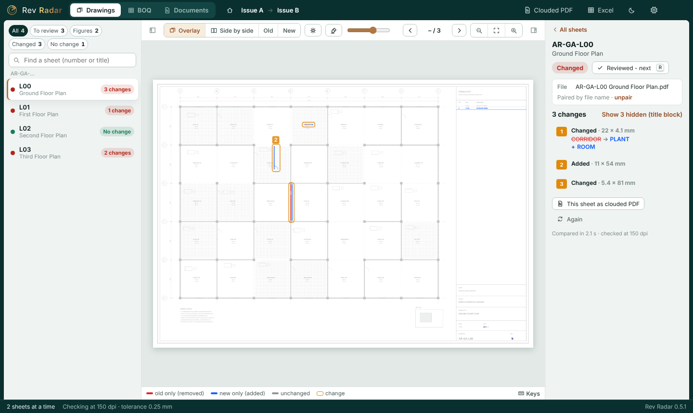
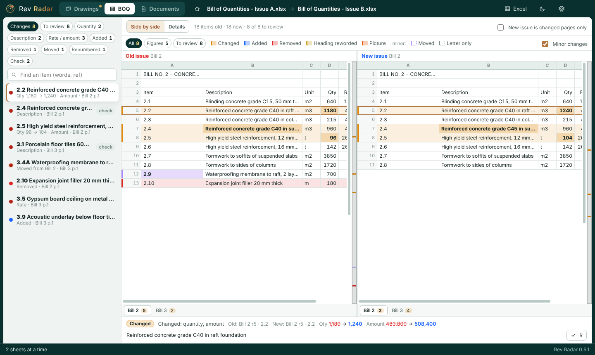
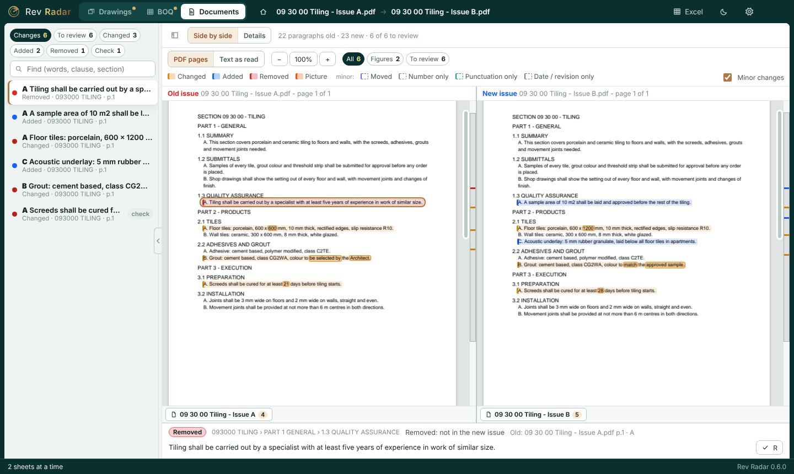

# Rev Radar

Rev Radar compares two issues of the same drawings, bills of quantities (BOQs) or specifications,
and shows what really changed - sheet by sheet, item by item, clause by clause.

> Let's help the people get through the tough work, the tough grind.

Free for anyone to use. Windows 10 / 11, 64-bit.

## Download

Get **Rev-Radar-Setup-&lt;version&gt;.exe** from the [Releases](https://github.com/nabilmunla/rev-radar/releases)
page and run it. It installs for everyone on the PC (asks for admin rights once) or just for you.
Windows may say "Windows protected your PC" (the setup has no paid certificate): press More info, then
Run anyway. Once installed, Rev Radar tells you when a new version is out (see Updates).

## The three tabs

### Drawings

Drop the old issue (a folder of PDFs, a few PDFs or one combined PDF) on the left and the new issue
on the right. Every sheet is paired with the same sheet of the other issue - by the drawing number in its
file name, or by the words on the sheet - and compared. You see at once which sheets changed and where: each change is boxed
and numbered, removed lines in red, added in blue. Press **N** to go from change to change; a sheet
is ticked off once you have seen all of it. Export a clouded PDF of the changed sheets, or an Excel
list of every sheet.



### BOQ

Drop two issues of a bill of quantities (Excel or PDF). Every item is paired wherever it went -
another page, another bill - and you see what changed: quantities, units, rates, amounts and
descriptions, items added, removed or moved. Old and new side by side; click a change on one side
and the other side goes to it. Export the change register to Excel.



### Documents

Drop two issues of a specification or any other document (PDF or Word). Paragraphs are paired
clause by clause; the words taken out and put in are marked on the pages themselves. Minor changes
(renumbering, punctuation, a date) are told apart and can be hidden. Scanned pages are read with
OCR. Pictures inside the pages are compared as pictures; the words inside a picture are not read.



(The pictures are made from generated sample files.)

## Updates

About 20 seconds after it starts, and every 4 hours, Rev Radar looks at this repository's latest
release. A new version is offered on a card - nothing is downloaded until you press **Update**.
Every release is signed by its maker: a release that isn't signed, or a file that doesn't match
what was signed (SHA-256), is refused. No helper program is ever started for an update; Rev Radar
restarts itself onto the new version. Settings > Updates can go back to the version before.

## Privacy

Rev Radar works offline. Your drawings, BOQs and documents never leave your PC. Besides looking
for new versions here, the only things it can send are:

- **the user count**, once a day, if you leave it on: a random number made on your PC (not linked
  to you), the app version, and Windows or Linux - nothing else. It asks first; Settings > Privacy
  turns it off.
- **a problem report**, only when you write one and press Send (Settings > Help > Report a problem).
- **crash reports**, only if you turn them on in Settings > Help.

Reports are made anonymous before they leave: your user name, the PC's name, file names, folders and
paths are taken out of the error and the app's log; never a file. What you type goes as you typed it,
so don't name a project in it. Reports and the count go to the developer's own small receiver (hosted
on Cloudflare), not to any analytics or crash-reporting company. Like any web host, Cloudflare and
GitHub see your internet address. A copy built from source names no
receiver and sends none of them.

## Building from source

```
npm ci
node scripts/build.mjs
npx electron .
```

`npm test` runs the unit tests. The setup is built with Go (`installer/`).

## Licence

Rev Radar is free software under the GNU Affero General Public License v3 or later
([LICENSE](LICENSE)), because it includes MuPDF, which is AGPL. The licences of every part inside
it are in [THIRD-PARTY-NOTICES.txt](THIRD-PARTY-NOTICES.txt).

Made by Nabil Munla.
